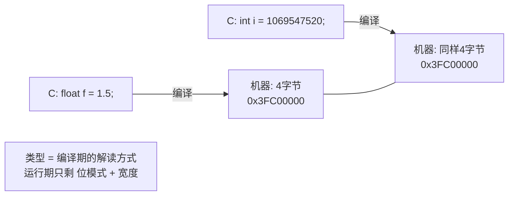

# 汇编中的数据类型

## 核心结论：汇编没有类型，只有宽度

C语言的世界里，`int`、`float`、`struct Point` 是三种截然不同的东西；汇编的世界里，**一切都只是"多少个字节的内存"**。所谓"类型"，是C编译器写进你脑子里的约定：



同一段4字节 `0x3FC00000`：当float读是1.5，当int读是1069547520——**解读方式来自指令，不来自数据本身**（实测见[联合类型·movd](../C语言/联合类型.md)：一条`movd`就能在两种解读间切换）。

## 宽度即"类型"：PTR 关键字

x86 Intel语法用 `宽度 PTR` 说明操作尺寸（全部为真实编译输出）：

```asm
mov     BYTE PTR [rdi], sil     ; 1字节写（set_c：p->c = v）
movzx   eax, WORD PTR 8[rdi]    ; 2字节读（get_s：p->s2）
mov     eax, DWORD PTR 4[rdi]   ; 4字节读（get_i：p->i）
movsd   xmm0, QWORD PTR 16[rdi] ; 8字节读（get_d：double走SSE！）
mov     QWORD PTR -24[rbp], rax ; 8字节写（存指针）
```

规则：

1. 寄存器名自带宽度（al=1字节、ax=2、eax=4、rax=8）——`mov eax, ...` 不用写DWORD；
2. 操作数是**内存地址**时必须用PTR注明宽度——CPU不知道你要几个字节；
3. 立即数的宽度由另一侧操作数决定。

## "类型"在哪一层起作用

| 层 | 有没有类型 | 说明 |
| --- | --- | --- |
| C源码 | ✔ | `int*`/`float`/`struct`，编译器检查 |
| 汇编 | ✘（只有宽度） | mov/add不区分"这是不是指针" |
| 机器码 | ✘ | 纯位模式 |
| **编译器的记忆** | ✔ | 偏移表、对齐、类型检查全在编译期完成，运行期不留痕迹 |

实测印证（[结构体·实战](../C语言/结构体.md)）：`p->i` 翻译成 `mov eax, DWORD PTR 4[rdi]`——**"i是int、偏移4"这个类型信息，编译完就变成了指令里的常量4**。类型不在内存里，在指令里。

## 浮点：另一套寄存器、另一套"类型"

整型走 rax 族，浮点走 xmm 族——这是汇编层面最接近"类型区分"的东西：

```asm
cvtsi2sd  xmm0, edi        ; "int→double"这条指令，本质是搬运+改编码
movsd     xmm0, QWORD PTR 16[rdi]   ; double成员读取
movd      eax, xmm0        ; 32位位模式原样搬进整数寄存器
```

返回值约定也分家：整型返回走 **rax**、浮点返回走 **xmm0**（实测：[结构体·get_d](../C语言/结构体.md)、[类型转换·实验2](../C语言/类型转换.md)）。

## 数据定义指示（.s文件里的"类型声明"）

真实 `.s` 输出（[数组·实验6](../C语言/数组.md)、[函数指针·实战](../C语言/函数指针.md)）：

```asm
	.data
g_init:
	.long	1                ; 4字节：int
	.long	2
	.long	3
	.long	4

	.data.rel.ro                 ; 函数指针表段
table.0:
	.quad	inc                  ; 8字节：函数地址
	.quad	dec

	.rodata
.LC0:
	.string	"hello"           ; 变长：以\0结尾

	.bss
g_bss:
	.zero	16                 ; 16字节全零（不占文件体积）
```

| 指示 | 相当于C的 | 宽度 |
| --- | --- | --- |
| `.byte 0x55` | `char` | 1 |
| `.word` | `short` | 2 |
| `.long` | `int` / `float`（位模式） | 4 |
| `.quad` | `long long` / 指针 / `double`（位模式） | 8 |
| `.string "..."` | 字符串字面量 | len+1 |
| `.zero N` | 未初始化数组 | N |
| `.float 1.5` | `float`（自动转位模式0x3FC00000） | 4 |
| `.double 1.5` | `double` | 8 |

## 有符号/无符号：不在数据里，在指令里

`0xFFFFFFFF` 到底是-1还是4294967295？取决于**用什么指令读它**（实测：[类型转换·实验3](../C语言/类型转换.md)）：

```asm
cmp     edi, esi
setl    al              ; 带符号解读：0xFFFFFFFF = -1 → -1 < 1 为真
...
cmp     edi, esi
setb    al              ; 无符号解读：0xFFFFFFFF = 4294967295 → 为假
```

同样的数据、同样的cmp，**setl/setb 两条指令给出两种"类型"的结果**——这就是"EFLAGS两套标志"的意义（详见[EFLAGS寄存器](EFLAGS寄存器.md)）。

## C类型 → 汇编对照总表

| C类型 | 宽度指示 | 典型指令 | 寻址/返回 |
| --- | --- | --- | --- |
| `char` | `.byte` | `mov al` / `BYTE PTR` | 整数族 |
| `short` | `.word` | `movzx eax, WORD PTR` | 整数族 |
| `int` | `.long` | `mov eax, DWORD PTR` | rax |
| `long long`（64位） | `.quad` | `mov rax, QWORD PTR` | rax |
| `float` | `.float` | `movss`（SSE） | xmm0 |
| `double` | `.double` | `movsd`（SSE） | xmm0 |
| 指针 | `.quad`（64位） | `mov rax, QWORD PTR` / `lea` | rax |
| `struct` | （无对应） | 成员=基址+常量偏移 | 按大小走寄存器/栈 |
| `union` | （无对应） | **零指令**，同址不同宽度读 | — |
| 函数指针 | `.quad` | `lea取址` + `call reg` | rax |
| `bool`（C99） | `.byte` | `test` + `sete/setne` | al |

## 小结

1. 汇编没有类型只有宽度；类型是编译期的约定，运行期只剩**位模式+宽度+指令**；
2. `BYTE/WORD/DWORD/QWORD PTR` 是汇编的全部"类型系统"；
3. 浮点自成体系（xmm族+movss/movsd），返回值也分家（rax vs xmm0）；
4. 有符号/无符号由指令选择（setl/setb、jl/ja），不由数据决定；
5. `.long/.quad/.string/.zero` 是数据在文件里的宽度说明书——逆向看数据段先看指示。
