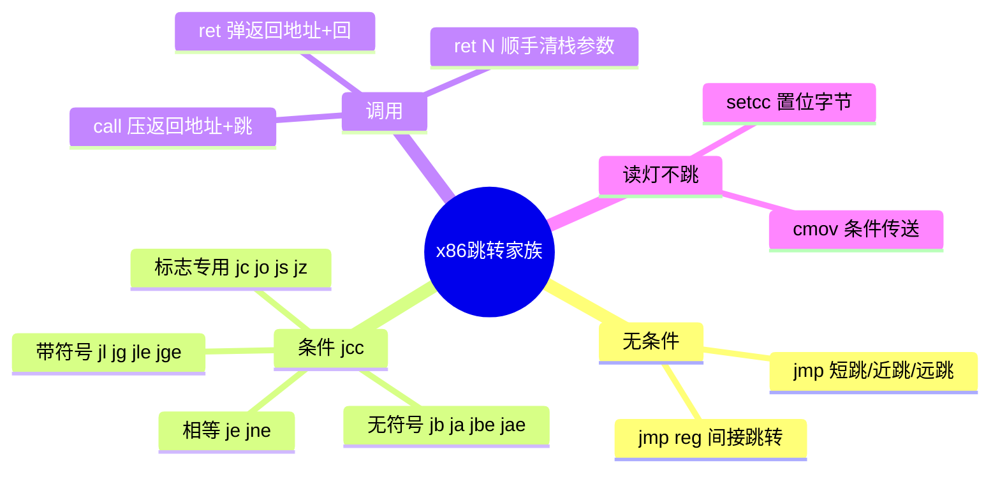

# 跳转指令集

## 没有"结构"，只有跳转

C的 if/while/for/switch/函数调用，编译后全部坍缩为**三种跳转**：



> 汇编里**没有"循环"这种东西**——循环=条件跳转往回跳（往低地址方向跳）。逆向时看到 `jl/jne` 跳回上方，闭着眼断定循环体尾部。

## 无条件跳转：jmp

```asm
jmp     .L3                  ; 直跳标签（编译器内部标签）
jmp     rax                  ; ★间接跳转：目标在寄存器里
jmp     QWORD PTR [rdx+rax*8]  ; ★查表跳转——函数指针表分发/switch跳转表
```

间接跳转的三大来源（全为本库实测）：

| 形态 | 实测来源 | C对应 |
| --- | --- | --- |
| `jmp rax` | apply尾调用 | `return op(x,y);`（尾位置函数指针） |
| `jmp [rdx+rax*8]` | dispatch跳转表 | `table[op](v)` |
| `jmp rax`（查表算出） | switch密集case | `switch(x)` |

## 条件跳转：jcc（读EFLAGS的灯）

条件表与两套世界观详见[EFLAGS寄存器](EFLAGS寄存器.md)。实测形态速览：

```asm
; if/else —— cmp+jle（[分支·实战]）
cmp     eax, DWORD PTR -8[rbp]
jle     .L2                  ; a<=b → else分支
...
; while —— jl回跳（[循环·实战]）
.L2:
cmp     eax, DWORD PTR -20[rbp]
jl      .L3                  ; i<n → 回跳循环体 ★往回跳=循环
; 循环反转后 —— jne尾检（[循环·实战]）
cmp     rdi, rax
jne     .L3                  ; do-while尾部
; switch越界防线 —— ja（[分支·实战]）
cmp     DWORD PTR -4[rbp], 5
ja      .L2                  ; 无符号比较：负数也当大数→default
; 判零 —— test+je
test    edi, edi
je      .L4                  ; x==0 → 出口
```

## call/ret：带"回程票"的跳转

```asm
call    add                  ; ①把下一条指令地址压栈 ②跳去add
...
add:    ...
ret                         ; 弹栈顶当地址跳回——"回程票"
```

**call与jmp的唯一区别**：call多压一个返回地址。实测全景（[函数·实战](../C语言/函数.md)）：

```asm
main:
    mov     esi, 2
    mov     edi, 1
    call    add              ; ← 此处隐式push返回地址到[rsp]
    mov     DWORD PTR -4[rbp], eax   ; 返回后从eax接结果
add:
    push    rbp              ; 新栈帧开始
    ...
    pop     rbp
    ret                      ; 弹返回地址，回到main的call下一行
```

**ret N**（32位stdcall专属）：弹返回地址后 `esp += N` 顺手清掉栈参数——被调方清栈的调用约定（见[参数传递](参数传递.md)）。

## 不跳转的"条件执行"

现代编译器（-O2）大量用**读灯不跳**的替代品（实测均见[分支·实战](../C语言/控制语句-分支和跳转.md)）：

```asm
; cmov 条件传送 —— if/else的化身
cmp     edi, esi
mov     eax, esi
cmovge  eax, edi             ; 无分支版max

; setcc 置位 —— 比较表达式的化身
cmp     edi, esi
setl    al                   ; a<b → al=0/1
```

动机：**跳转破坏流水线**。CPU采用分支预测赌方向，赌错清空流水线（十几周期）。cmov/setcc不赌，两条路都算好再挑——小结果的条件逻辑因此去跳转化。

## 跳转距离：短/近/远

| 类型 | 范围 | 机器码长度 |
| --- | --- | --- |
| 短跳 short | ±127字节 | `EB xx`（2字节） |
| 近跳 near | ±2GB（32位） / ±2GB（64位rel32） | `E9 xxxx`（5字节） |
| 远跳 far | 跨段（现代OS基本绝迹） | `EA ...` |

逆向细节：**短跳才是压缩空间**——gcc用 `.p2align` 对齐热点循环、把冷代码外抛，本质都在管理跳转距离与流水线。patch二进制时若把短跳改长，后续指令全部错位——crackme补丁的经典崩法。

## 特殊：loop 指令（认识即可）

```asm
mov     ecx, 10
.L1:
    ...
    loop    .L1              ; ecx-- 后非零则跳（一条指令的计数循环）
```

历史产物：一条指令干"减一+判零+跳"。**现代编译器从不生成它**（太慢：无法与分支预测配合）——只在手写汇编和老教材里出没。

## 全家福：跳转指令与C结构对照（实测归纳）

| C结构 | 机器形态 | 实测来源 |
| --- | --- | --- |
| `if/else` | `cmp+jcc` + `jmp`汇合 → -O2变`cmov` | 分支·实验1 |
| `switch` 密集 | 越界`ja` + 查表`jmp [表+idx*8]` | 分支·实验2 |
| `switch` 稀疏 | `cmp/je` 链（二分排序） | 分支·实验3 |
| `while/for` | 先`jmp`去检查 + `jl`回跳（-O0） | 循环·实验1 |
| 循环（-O2） | 守卫 + 尾部`jne`回跳 | 循环·实验3 |
| `continue` | `jmp`步进前nop垫 | 循环·实验2 |
| `break` | `jmp`出口nop垫 | 循环·实验2 |
| `goto` | 一条`jmp/je`直达标签 | 分支·实验4 |
| 函数调用 | `call`压返回地址 + `ret`弹回 | 函数·实验1 |
| 函数指针调用 | `call rcx`（call寄存器） | 函数指针·实验1 |
| 尾调用 | `jmp rax`（不压返回地址） | 函数指针·apply |
| `&&` 短路 | 两次`test`串接，前者假直接跳过 | flags·both_nonzero |

## 小结

1. 三大件：jmp（无条件）、jcc（读灯条件跳）、call/ret（带回程票）——C的一切控制流由此拼装；
2. **往回跳的条件跳转=循环**，这是逆向识别循环的唯一依据；
3. 间接跳转（jmp reg / jmp [表]）= switch跳转表或函数指针——查表形态直接暴露数据结构；
4. -O2用cmov/setcc大量替代跳转（分支预测太贵）——现代逆向要认识"没有跳转的if"；
5. call与jmp差一个压栈的返回地址；ret N 是32位stdcall的清栈签名。
