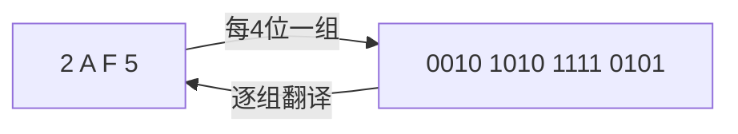

# 进制

## 为什么必须掌握进制

CPU 只认**二进制**；汇编里全程使用**十六进制**（紧凑、与二进制逐4位对应）；逆向工具（OD/IDA/x64dbg）的内存窗口、寄存器窗口、机器码全是十六进制。不会进制转换 = 看不懂任何调试器。

## 四种进制速览

| 进制 | 基数 | 数码 | C语言前缀 | 汇编后缀 | 例子 |
| --- | --- | --- | --- | --- | --- |
| 二进制 | 2 | 0,1 | `0b1010`（C23标准/gcc扩展） | `1010b` | 10进制=10 |
| 八进制 | 8 | 0~7 | `012` | `12o` | 10进制=10 |
| 十进制 | 10 | 0~9 | `12` | `12d`（可省） | 12 |
| 十六进制 | 16 | 0~9,A~F | `0xC` | `0Ch` | 10进制=12 |

> ⚠️ C语言陷阱：`int x = 012;` 是**八进制**（=10），不是12——前导零有含义，老代码高发事故。

## 二进制 ↔ 十六进制：4位一换（必须形成条件反射）

十六进制每一位恰好对应二进制4位（16 = 2⁴）：



对照表（背下来）：

| 十六进制 | 二进制 | 十进制 | 十六进制 | 二进制 | 十进制 |
| --- | --- | --- | --- | --- | --- |
| 0 | 0000 | 0 | 8 | 1000 | 8 |
| 1 | 0001 | 1 | 9 | 1001 | 9 |
| 2 | 0010 | 2 | A | 1010 | 10 |
| 3 | 0011 | 3 | B | 1011 | 11 |
| 4 | 0100 | 4 | C | 1100 | 12 |
| 5 | 0101 | 5 | D | 1101 | 13 |
| 6 | 0110 | 6 | E | 1110 | 14 |
| 7 | 0111 | 7 | F | 1111 | 15 |

例子：`0xDEADBEEF` → `1101 1110 1010 1101 1011 1110 1110 1111`（不用计算器，逐位默写）。

## 十进制 ↔ 二进制转换

**十→二：除2取余倒排**

```text
13 ÷ 2 = 6 …… 1   ↑
 6 ÷ 2 = 3 …… 0   │
 3 ÷ 2 = 1 …… 1   │ 从下往上读
 1 ÷ 2 = 0 …… 1   │
→ 1101            ┘
```

**二→十：按权展开**

```text
1101 = 1×2³ + 1×2² + 0×2¹ + 1×2⁰ = 8 + 4 + 0 + 1 = 13
```

**快捷法（逆向常用）**：记住权值序列 1,2,4,8,16,32,64,128,256,512,1024…，把数拆成权值之和。
例：`100 = 64 + 32 + 4 = 0b1100100`；`0x80 = 128`、`0xFF = 255`、`0x100 = 256` 必须秒答。

## 有符号数：最高位是符号位

8位有符号数的编码（详见[数据宽度](数据宽度.md)）：

```text
最高位=0 → 正数：0x01~0x7F = 1~127
最高位=1 → 负数：0xFF=-1, 0xFE=-2, …, 0x80=-128
```

**负数速算**：`-N` 的二进制 = `N` 按位取反加1（补码）。
例：`-1`：`1 = 0000 0001` → 取反 `1111 1110` → +1 = `1111 1111` = 0xFF。

逆向实例：调试器里见到 `EAX = FFFFFFFF`，第一反应是 **-1**（不是"4294967295"）——是否当负数看取决于指令（`cmp+jl` 当负、`cmp+ja` 当正，见[EFLAGS](EFLAGS寄存器.md)）。

## 进制在真实汇编里的样子

来自本库实测汇编的真实片段（gcc 13.3 / x86-64）：

```asm
mov     eax, 305407301        ; 十进制立即数（常量折叠的产物）
mov     edx, DWORD PTR g[rip] ; 段内偏移用符号表示
imul    rax, rax, 1717986919  ; ★魔数 = 0x66666667（x/10的除法替代）
mov     DWORD PTR -14[rbp], 1819438967  ; = 0x6C726F77 = "worl"四个字符！
and     eax, -9               ; = 0xFFFFFFF7（~(1<<3)清位掩码）
and     eax, 7                ; = 0b111（位域宽度掩码）
sal     rax, 2                ; ×4 = ×2²（移位即乘法）
```

看见没有：**同一串二进制，可以有十进制、十六进制、字符、掩码四种解读**——进制转换是逆向的"识字"环节。

**0x6C726F77 的分解**（小端：低字节在前）：

```text
0x6C726F77 → 6C 72 6F 77 → 'l' 'r' 'o' 'w' → 内存里读出来就是 "worl"
```

——这就是字符串 `"world"` 被编译成立即数的全部秘密（详见[常量区·实战](../C语言/常量区.md)）。

## 移位与进制的亲缘

左移1位 = ×2，右移1位 = ÷2（无符号）。乘除2的幂全部变成移位：

| 乘法 | 移位等价 | 实测来源 |
| --- | --- | --- |
| ×2 | `lea eax,[rsi+rsi]` | 位域写（mode<<1） |
| ×4 | `sal rax,2` | malloc的n*sizeof(int) |
| ×8 | `lea eax,0[0+rdi*8]` | x<<3（SIB比例因子） |
| ÷4 | `sar rax,2` | int指针相减 |
| ÷2 | `sar rax` | short指针相减 |

详见[位运算·实战](../C语言/位运算.md)。

## 练习

1. `0xB0C` = ?（十进制）
2. `-5` 的8位补码？
3. `0x0F0F` 的二进制？
4. 调试器中 `[ebp+0xC]` 是第几个参数？（32位cdecl，见[参数传递](参数传递.md)）

<details><summary>答案</summary>

1. 11×256 + 0×16 + 12 = 2828
2. 5=0000 0101 → 取反 1111 1010 → +1 = **1111 1011** (0xFB)
3. 0000 1111 0000 1111
4. 第2个参数（`[ebp+8]`是第1个、`[ebp+0xC]`是第2个）
</details>
