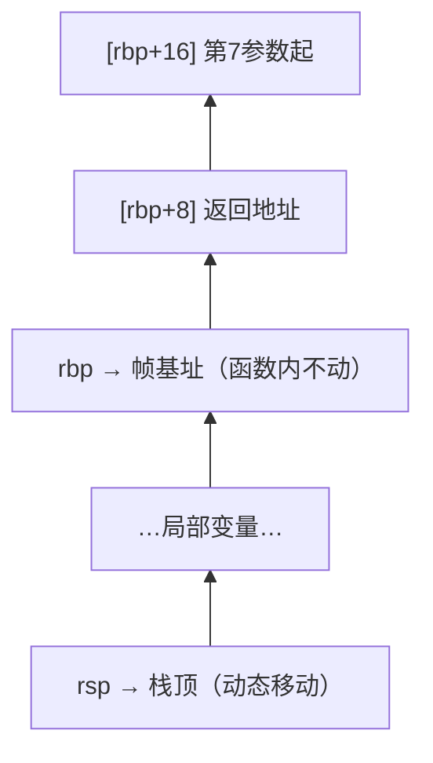

# 通用寄存器

## 寄存器是CPU的"口袋"

CPU 内部的超高速存储单元，**离运算器最近、数量最少、速度最快**。所有运算的数据必须先进寄存器（x86的add不能直接加两个内存数）。

## 32位经典八兄弟（滴水/OD视角）

| 寄存器 | 真名 | 专长（历史约定） |
| --- | --- | --- |
| EAX | Accumulator | 累加器：**乘除默认操作数、函数返回值** |
| ECX | Counter | 计数器：循环计数（loop指令）、移位次数（**shl eax, cl**） |
| EDX | Data | 数据：乘除的高半部分（cdq的搭档）、32位下第二返回值 |
| EBX | Base | 基址（曾经的段内基址） |
| EBP | Base Pointer | **栈帧基址**：`[ebp±n]`访问参数与局部变量 |
| ESP | Stack Pointer | **栈顶指针**：永远指向栈顶 |
| ESI | Source Index | 源变址：串操作源（movs） |
| EDI | Destination Index | 目的变址：串操作目标 |

> EAX/ECX/EDX 是"易碎品"（caller-saved，函数随便用）；EBX/ESI/EDI/EBP/ESP 是"保管品"（callee-saved，用前必须保存）——这条线就是[C语言·调用约定](../C语言/函数.md)的全部内容，实测见[循环·rbx跨call存活](../C语言/控制语句-循环.md)。

## 64位扩展：R前缀 + 新增8个

64位把32位全部加宽（rax…r15），并新增 r8~r15：

| 64位 | 32位 | 16位 | 8位 |
| --- | --- | --- | --- |
| rax | eax | ax | al |
| rbx | ebx | bx | bl |
| rcx | ecx | cx | cl |
| rdx | edx | dx | dl |
| rsi | esi | si | sil |
| rdi | edi | di | dil |
| rbp | ebp | bp | bpl |
| rsp | esp | sp | spl |
| r8 | r8d | r8w | r8b |
| … | … | … | … |
| r15 | r15d | r15w | r15b |

**System V AMD64 参数寄存器顺序（64位Linux/macOS必背）**：

```text
整型/指针参数：rdi, rsi, rdx, rcx, r8, r9（第7个起走栈）
浮点参数：xmm0~xmm7
返回值：rax（浮点xmm0）
```

## 实测：寄存器的分工（gcc 13.3 / x86-64 / -O2 真实输出）

```c
int add(int a, int b) { return a + b; }
/* main: add(10, 3) */
```

```asm
add:
    endbr64
    lea     eax, [rdi+rsi]     ; ★参数直接从rdi/rsi拿来算——64位第一现场
    ret                          ; 返回值已在eax
```

```asm
/* 32位 cdecl 的同款函数（经典对照）：
    push ebp
    mov  ebp, esp
    mov  eax, [ebp+8]      ; 第1参数从栈上取
    add  eax, [ebp+12]     ; 第2参数
    pop  ebp
    ret                     ; cdecl：调用方add esp,8清栈 */
```

**两代分水岭一眼看穿**：32位参数压栈、`[ebp+8]`起取；64位参数进寄存器、栈上只剩第7个起（实测：[函数·第7参数rbp+16](../C语言/函数.md)）。

## 实测：子寄存器的隐式规则——写32位自动清零高32位

```c
unsigned char  low8(unsigned x)  { return (unsigned char)x; }
unsigned short low16(unsigned x) { return (unsigned short)x; }
unsigned int   low32(unsigned long x) { return (unsigned int)x; }
```

**-O2 真实输出——三个函数长得一模一样**：

```asm
low8:
    mov     eax, edi           ; 就这一条！
    ret
low16:
    mov     eax, edi           ; 完全相同！
    ret
low32:
    mov     eax, edi           ; 还是相同！
    ret
```

为什么截断到char/short/int的函数零差异？——**x86-64铁律：写32位寄存器（eax）会自动把高32位清零**。所以"截断到32位以内"这个动作，`mov eax, edi` 一条指令顺手就完成了（调用方按al/ax/eax取窄值）。

对照：**宽化**必须显式指令：

```asm
widen(int→long):     movsx   rax, edi    ; 符号扩展（负数补符号位）
widen_u(unsigned→long): mov  eax, edi    ; 零扩展——又是靠"写eax自动清零"！
```

> 32位世界没有这条规则：写al只改低8位、ah原样保留——`mov eax, 0` 后 eax 可能不是0？不，32位下写al不影响eax高位。所以32位汇编里常见 `xor eax,eax` 先清零再写al的套路。

## 实测：专用寄存器的"专长"现形

| 场景 | 寄存器 | 真实指令（来源） |
| --- | --- | --- |
| 返回值 | eax/rax | `mov eax, 240; ret`（fact尾递归） |
| 乘除 | rax+rdx | `cdq; idiv esi`（除法前奏，edx被征用） |
| 移位次数 | cl | `shr eax, cl`（变移位时）；常量移位直接`shr eax,3` |
| 栈帧 | rbp/rsp | `push rbp; mov rbp,rsp`（每个-O0函数序言） |
| 参数 | rdi~r9 | `mov edi,4; call make`（malloc实验） |
| 串操作 | rdi/rsi | `movaps`/memcpy的SSE版 |
| callee-saved | rbx | `push rbx; mov ebx,eax; call…`（跨call存中间值） |

## SP/BP 的特殊性

**rsp 永远指向栈顶**——任何push/pop/mov [rsp-N] 都隐式依赖它；**rbp 是"坐标原点"**——局部变量`[rbp-4]`、参数`[rbp+16]`全靠它定位：



-O2 常常省掉rbp（直接rsp±N寻址，实测见[循环反转实验](../C语言/控制语句-循环.md)的`-8[rsp]`）——逆向时遇到无rbp函数，参数定位改看rsp。

## 小结

1. 8个32位经典（EAX累加/ECX计数/EDX乘副手/EBP栈基/ESP栈顶/ESI·EDI变址）+ 64位新增r8~r15；
2. caller-saved（rax/rcx/rdx/rsi/rdi）vs callee-saved（rbx/rbp/rsp/r12~r15）——调用约定的地基；
3. 64位参数走 rdi,rsi,rdx,rcx,r8,r9，第7个起走栈（`[rbp+16]`）；
4. **x86-64写32位寄存器自动清零高32位**——截断函数零指令、零扩展白嫖一条mov（实测三函数同码）；
5. rsp永远指栈顶、rbp是帧坐标——`[ebp+8]`（32位）/`[rbp+16]`（64位栈参数）是逆向第一反射。
